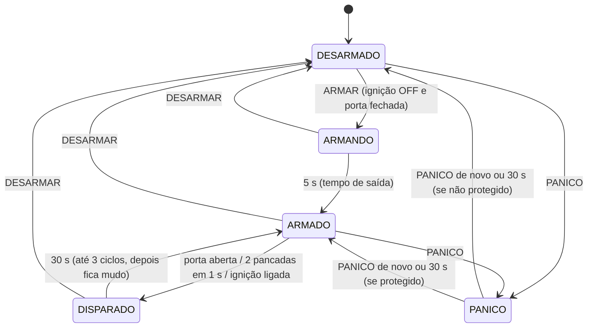

# Alarme automotivo com 2 × ESP32

Alarme com **chaveiro** (ESP32 em deep sleep, ESP-NOW), **controlador veicular** (ESP32 com relés, sensores e GPS)
e **app Flutter** (BLE, comandos de voz em pt-BR e mapa).

```
 ┌──────────────┐   ESP-NOW (2,4 GHz, HMAC + contador)   ┌─────────────────────────┐
 │  CHAVEIRO    │ ─────────────────────────────────────► │  CONTROLADOR VEICULAR   │
 │  ESP32 + 3   │ ◄───────────────────────────────────── │  ESP32                  │
 │  botões      │      confirmação (com o estado)        │  relés, sensores, GPS   │
 └──────────────┘                                        └───────────┬─────────────┘
                                                                     │ BLE (NUS + PIN)
                                                         ┌───────────▼─────────────┐
                                                         │  CELULAR (app Flutter)  │
                                                         │  voz pt-BR, GPS, mapa   │
                                                         └─────────────────────────┘
```

> ⚠️ **Projeto de bancada/hobby, não testado em veículo.** Mexer em travas, bomba de combustível e fiação
> original pode afetar segurança, garantia e seguro. Sem experiência com elétrica automotiva, peça apoio de um
> instalador. Confira também a legislação local sobre sirenes e bloqueadores.

## Sumário
1. [Estrutura do projeto](#estrutura-do-projeto)
2. [Funcionalidades](#funcionalidades)
3. [Materiais](#materiais)
4. [Ligações](#ligações)
5. [Passo a passo](#passo-a-passo)
6. [Comportamento do alarme](#comportamento-do-alarme)
7. [Protocolos](#protocolos)
8. [App Flutter](#app-flutter)
9. [Segurança](#segurança)
10. [Testes de bancada](#testes-de-bancada)
11. [Solução de problemas](#solução-de-problemas)
12. [Limitações e próximos passos](#limitações-e-próximos-passos)

## Estrutura do projeto

```
alarme-esp32/
├── README.md
├── .gitignore
├── docs/
│   ├── conferencia_pinos.md          # código × esquemáticos, pino a pino
│   ├── revisao_firmware.md           # bugs encontrados e correções
│   └── hardware/
│       ├── esquematico_controlador.jpg
│       ├── esquematico_controlador_easyeda.png
│       └── esquematico_chaveiro.svg
├── firmware/
│   ├── common/
│   │   └── protocolo.h               # fonte da verdade (pacote, HMAC, enums)
│   ├── controlador/                  # sketch do módulo do carro
│   │   ├── controlador.ino
│   │   ├── protocolo.h               # cópia (gerada)
│   │   └── segredos.h                # GERADO, fora do git
│   └── transmissor/                  # sketch do chaveiro
│       ├── transmissor.ino
│       ├── protocolo.h               # cópia (gerada)
│       └── segredos.h                # GERADO, fora do git
├── app_flutter/
│   ├── lib/
│   │   ├── main.dart                 # UI, BLE, voz
│   │   └── comandos_voz.dart         # frase falada → comando (corrige o bug do "alarme")
│   └── test/
│       └── comandos_voz_test.dart
└── tools/
    ├── configurar.py                 # gera segredos.h e sincroniza protocolo.h
    └── segredos.json                 # GERADO, fora do git (chave, PIN, MACs)
```

Cada pasta de sketch tem o **mesmo nome** do `.ino`, como a Arduino IDE exige.

## Funcionalidades

- **Chaveiro:** armar, desarmar e pânico; bateria dura meses (deep sleep); LED mostra se o carro aceitou.
- **Controlador:** sensores de porta, choque e ignição; sirene, pisca-alerta, trava/destrava e corte da bomba.
- **Celular:** botões, **comando de voz**, estado em tempo real, alerta de disparo, posição GPS e abrir no mapa.
- Estado "armado" **persiste** em flash: se faltar energia, o módulo volta armado.
- Corte de combustível com relé **NF** (fail-safe) e só ativado com a ignição desligada.

## Materiais

| Qtd | Item | Observação |
|---|---|---|
| 2 | ESP32 (**WROOM**, não WROVER) | GPIO16/17 são usados pela PSRAM no WROVER |
| 1 | Módulo de 5 relés 5 V com optoacoplador | confira se é ativo em ALTO ou BAIXO (`RELE_ON`) |
| 1 | GPS NEO-6M | |
| 1 | Sensor de vibração SW-420 | |
| 1 | PC817 + resistor 2,2 kΩ + 1N4148 | sensor de porta isolado |
| 1 | Resistores 47 kΩ e 10 kΩ, capacitor 100 nF, zener 3,3 V | divisor da ignição |
| 1 | Buck 12 V → 5 V automotivo (≥ 2 A) + TVS SMBJ24A + fusível 2 A | |
| 3 | Botões táteis | chaveiro |
| 1 | LiPo 3,7 V + LDO de baixo consumo + carregador com proteção | chaveiro |
| — | LEDs, resistores 330 Ω, fusíveis individuais (sirene, bomba) | |

## Ligações

Esquemáticos em [`docs/hardware/`](docs/hardware/). A conferência completa, com divergências encontradas,
está em [`docs/conferencia_pinos.md`](docs/conferencia_pinos.md).

### Controlador
| Pino | Função | Observação |
|---|---|---|
| 23 / 22 | Relés travar / destravar | Pulso de 400 ms; a ligação depende do carro (2 relés em H ou pulso +/−) |
| 21 | Relé da sirene | Fusível próprio |
| 19 | Relé do pisca-alerta | |
| 18 | Relé de corte da bomba | Contato **NF** → sem energia o carro funciona |
| 32 | Sensor de porta | LOW = aberta. PC817 entre o 12 V e o ESP32, pull-up interno |
| 27 | Sensor de choque SW-420 | Ajuste `CHOQUE_ATIVO` conforme seu módulo |
| 34 | Ignição (ADC1) | Divisor 47 kΩ / 10 kΩ do 12 V da ignição + 100 nF + zener 3,3 V |
| 16 / 17 | GPS NEO-6M | **TX do GPS → GPIO16**, **RX do GPS ← GPIO17** |
| 2 | LED de status | 330 Ω |

Alimentação: buck **12 V → 5 V** automotivo (com TVS) + fusível de 2 A no positivo do módulo; o 5 V vai no pino
`VIN`/`5V` do ESP32 e no módulo de relés.

### Chaveiro
| Pino | Função |
|---|---|
| GPIO25 / 26 / 27 | Botões ARMAR / DESARMAR / PÂNICO (cada um entre o pino e o **3V3**; pull-down interno) |
| GPIO2 | LED de confirmação (330 Ω) |
| — | LiPo 3,7 V + regulador de baixo consumo (≥ 250 mA com capacitor de bulk de 100–220 µF) |

## Passo a passo

### 1. Ferramentas
- Arduino IDE com **esp32 by Espressif 3.x** e a biblioteca **TinyGPSPlus**.
- Python 3 (para `tools/configurar.py`).
- Flutter SDK (para o app).

### 2. Segredos e pareamento (a ordem importa)
```bash
python tools/configurar.py
```
Isso cria `tools/segredos.json` com **chave HMAC e PIN BLE aleatórios**, e gera `segredos.h` nos dois sketches.

1. Grave `firmware/controlador/` e abra o Serial (115200): ele imprime `MAC do controlador: XX:XX:...`.
2. Edite `tools/segredos.json`, coloque esse valor em `mac_controlador` e rode `python tools/configurar.py`.
3. Grave `firmware/transmissor/`. Na 1ª energização ele imprime o **MAC do chaveiro** e dorme em 5 s.
4. Coloque o MAC em `mac_transmissor`, rode `python tools/configurar.py` e **regrave o controlador**.
5. O PIN do BLE está em `pin_ble` (é ele que o celular pede ao parear).

`python tools/configurar.py --nova-chave` sorteia novos segredos (é preciso regravar os dois ESP32).
Se o contador do chaveiro for apagado (flash limpa), regrave os dois para ressincronizar.

### 3. App
```bash
flutter create --project-name alarme_app app_flutter   # gera android/ e ios/
cd app_flutter
flutter pub add flutter_blue_plus speech_to_text url_launcher
flutter test                                            # roda os 26 casos de voz
flutter run
```
`flutter create` não sobrescreve `lib/` e `test/` já existentes; confirme que `lib/main.dart` continua o seu.

**Android** — `android/app/src/main/AndroidManifest.xml`, dentro de `<manifest>`:
```xml
<uses-permission android:name="android.permission.BLUETOOTH_SCAN" android:usesPermissionFlags="neverForLocation"/>
<uses-permission android:name="android.permission.BLUETOOTH_CONNECT"/>
<uses-permission android:name="android.permission.BLUETOOTH" android:maxSdkVersion="30"/>
<uses-permission android:name="android.permission.BLUETOOTH_ADMIN" android:maxSdkVersion="30"/>
<uses-permission android:name="android.permission.ACCESS_FINE_LOCATION" android:maxSdkVersion="30"/>
<uses-permission android:name="android.permission.RECORD_AUDIO"/>
<uses-permission android:name="android.permission.INTERNET"/>
<queries>
  <intent><action android:name="android.speech.RecognitionService"/></intent>
  <intent><action android:name="android.intent.action.VIEW"/><data android:scheme="https"/></intent>
</queries>
```
**iOS** — `ios/Runner/Info.plist`: `NSBluetoothAlwaysUsageDescription`, `NSMicrophoneUsageDescription`,
`NSSpeechRecognitionUsageDescription`.

## Comportamento do alarme



| Parâmetro | Padrão | Onde |
|---|---|---|
| Tempo de saída | 5 s | `TEMPO_SAIDA_MS` |
| Duração da sirene | 30 s | `TEMPO_ALARME_MS` |
| Ciclos antes de silenciar | 3 | `MAX_DISPAROS` |
| Filtro da porta / ignição | 50 ms / 300 ms | `FILTRO_PORTA_MS`, `FILTRO_IGN_MS` |
| Limiar da ignição | liga > 1300 mV, desliga < 900 mV | `IGN_LIGA_MV`, `IGN_DESLIGA_MV` |
| Intervalo do GPS | 5 s | `INTERVALO_GPS_MS` |

**Piscadas do LED do chaveiro:** 1 longa = aceito · 2 médias = o carro recebeu mas recusou (porta aberta,
ignição ligada…) · 3 rápidas = sem resposta.

## Protocolos

### ESP-NOW (chaveiro ⇄ controlador), canal 1
Pacote de 14 bytes (`packed`):

| Offset | Tam. | Campo | Descrição |
|---|---|---|---|
| 0 | 1 | `tipo` | 1 = comando, 2 = resposta |
| 1 | 1 | `valor` | comando (1 armar, 2 desarmar, 3 pânico, 4 buscar) ou estado (0–4) |
| 2 | 4 | `contador` | contador rolante (little-endian) |
| 6 | 8 | `hmac` | HMAC-SHA256 de `tipo‖valor‖contador`, truncado em 8 bytes |

Regras do controlador: aceita só o MAC pareado; assinatura válida; `contador` **maior** que o último
(salvo em flash); igual ao último = retransmissão (apenas reenvia a confirmação); menor = descarta.

### BLE (Nordic UART Service, com PIN)
| UUID | Sentido |
|---|---|
| `6e400001-b5a0-f393-e0a9-e50e24dcca9e` | serviço |
| `6e400002-…` | RX: celular → ESP32 (texto) |
| `6e400003-…` | TX: ESP32 → celular (notificações, linhas terminadas em `\n`, fatiadas em 20 bytes) |

**Celular → ESP32:** `ARMAR`, `DESARMAR`, `TRAVAR`, `DESTRAVAR`, `PANICO`, `BUSCAR`, `STATUS`, `LOCALIZAR`,
`RASTREAR:ON`, `RASTREAR:OFF`

**ESP32 → celular:** `ESTADO:<DESARMADO|ARMANDO|ARMADO|DISPARADO|PANICO>`, `GPS:<lat>,<lng>,<km/h>,<satélites>`
(ou `GPS:SEM_FIX`), `ALERTA:<PORTA|CHOQUE|IGNICAO>`, `OK:...`,
`ERRO:<JA_ARMADO|IGNICAO_LIGADA|PORTA_ABERTA|COMANDO_INVALIDO>`

## App Flutter

Comandos de voz reconhecidos (palavras inteiras, sem acento):

| Comando | Exemplos |
|---|---|
| ARMAR | "armar o alarme", "ativar o alarme", "ligar o alarme" |
| DESARMAR 🔒 | "desarmar", "desativar o alarme", "desligar o alarme" |
| TRAVAR | "travar as portas", "fechar o carro", "trancar" |
| DESTRAVAR 🔒 | "destravar", "abrir o carro", "destrancar" |
| PANICO | "pânico", "socorro", "emergência" |
| LOCALIZAR | "onde está meu carro?", "localizar", "rastrear" |
| BUSCAR | "achar o carro", "encontrar o carro" (pisca e bipa) |
| STATUS | "status", "situação do alarme", "como está o carro" |

🔒 = pede **confirmação na tela** antes de enviar. Frases com **negação** ("não desarme") ou **ambíguas**
("desarmar e travar") são ignoradas.

## Segurança

- Pacotes ESP-NOW assinados com **HMAC-SHA256** e **contador rolante** salvo em flash (bloqueia replay simples).
- O controlador só aceita o **MAC do chaveiro pareado**.
- BLE com **pareamento por PIN** e características + CCCD criptografados.
- Chave e PIN **aleatórios por instalação**, fora do git.
- Estado armado persiste em flash; corte de combustível só com a ignição desligada e fail-safe (relé NF).
- Desarmar/destravar por voz exigem confirmação.

**Não cobre:** captura + reenvio atrasado (RollJam) — veja `docs/revisao_firmware.md`; jamming do 2,4 GHz;
quem remover o fusível do módulo (o carro volta a funcionar de propósito).

## Testes de bancada

Antes do carro, com **LEDs no lugar dos relés**:

- [ ] `python tools/configurar.py --verificar` sem diferenças
- [ ] Controlador imprime o MAC; chaveiro imprime o MAC; nenhum `00:00:...` restante em `segredos.json`
- [ ] Chaveiro: ARMAR → LED do controlador pisca e Serial mostra `ARMANDO` → `ARMADO` em 5 s
- [ ] Chaveiro com o controlador desligado → 3 piscadas rápidas
- [ ] ARMAR com a porta "aberta" (GPIO32 em GND) → 2 piscadas médias no chaveiro
- [ ] Porta aberta armado → sirene; ruído curto (< 50 ms) na porta **não** dispara
- [ ] SW-420: uma pancada não dispara; duas em 1 s disparam (ajuste `CHOQUE_ATIVO` se invertido)
- [ ] Ignição: 12 V no divisor armado → `IGNICAO`; confira a tensão em GPIO34 (< 3,3 V sempre)
- [ ] Segurar PÂNICO por 5 s alterna **uma única vez**
- [ ] Tirar e recolocar a energia armado → volta `ARMADO`
- [ ] Reenviar um pacote gravado → controlador ignora (contador antigo)
- [ ] Celular sem parear não consegue escrever nem assinar notificações
- [ ] Frase "status do alarme" no app **não** arma
- [ ] Medir a corrente do módulo armado (multímetro em série) e estimar a autonomia da bateria

## Solução de problemas

| Sintoma | Causa provável |
|---|---|
| `#error "segredos.h não existe"` | rode `python tools/configurar.py` |
| Chaveiro sempre dá 3 piscadas | MAC trocado, canal diferente, ou `segredos.h` com chaves diferentes nos dois sketches (rode o script e regrave ambos) |
| Chaveiro acorda sozinho / bateria acaba | pull-down RTC não aplicado (veja a revisão) ou botão com fuga |
| Relé "colado" ligado | módulo ativo em BAIXO: use `#define RELE_ON LOW` |
| Choque dispara parado (ou nunca) | nível do `DO` invertido: ajuste `CHOQUE_ATIVO` e o potenciômetro do módulo |
| GPS sempre `SEM_FIX` | GPS TX/RX trocados ou ligados em GPIO1/3; antena sem visada do céu; espere 1–5 min no frio |
| `ADC2`/ignição instável | use só pinos ADC1 (GPIO32–39) com Wi-Fi ligado |
| Erro de compilação em `connect()` (`license`) | `flutter_blue_plus` ≥ 2.0 exige `license: License.free`; ou fixe `flutter_blue_plus: ^1.35.0` |
| Erro com `BLE2902`/CCCD duplicado | remova as 3 linhas do CCCD em `iniciarBle()` (seu core cria o descritor sozinho) |
| Celular não pede PIN | apague o pareamento antigo em Configurações → Bluetooth e conecte de novo |

## Limitações e próximos passos

- **Rastreamento por BLE só funciona com o celular perto (~10–30 m).** Para rastrear de qualquer lugar, adicione
  um módulo **GSM/LTE (SIM7600 / A7670)** e envie a posição por MQTT/HTTP.
- **Consumo contínuo do módulo no carro** (rádio ligado + relé do corte energizado). Meça e considere
  *light sleep* com janela de escuta ou BLE como único canal.
- Trocar o contador por **challenge-response** (nonce do carro) contra RollJam.
- Ideias: MPU6050 (inclinação/reboque), volumétrico (ultrassom), bateria de backup para a sirene, OTA,
  monitor de bateria no chaveiro, reconexão BLE automática no app.

Detalhes das revisões em [`docs/revisao_firmware.md`](docs/revisao_firmware.md) e das ligações em
[`docs/conferencia_pinos.md`](docs/conferencia_pinos.md).
